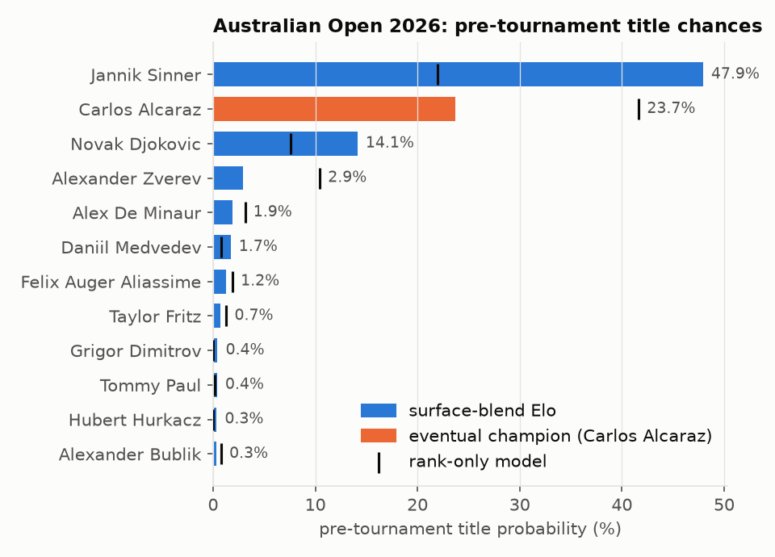
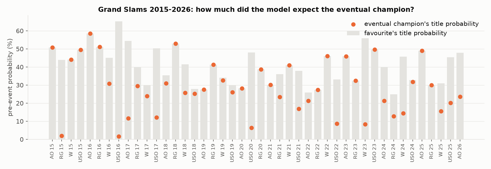
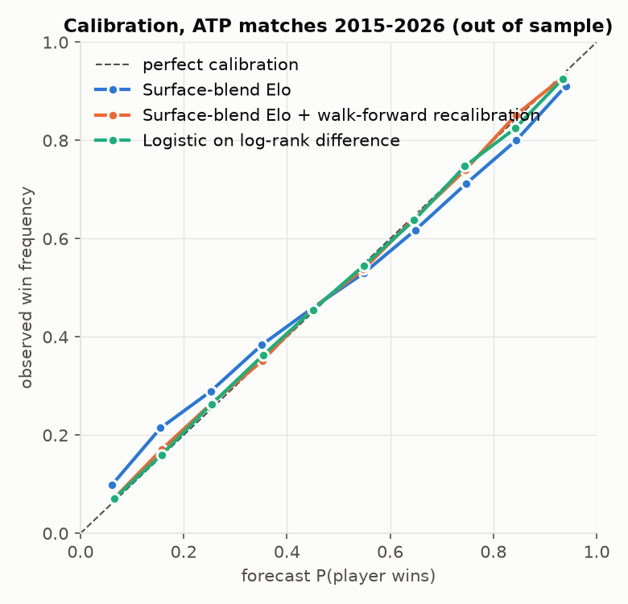
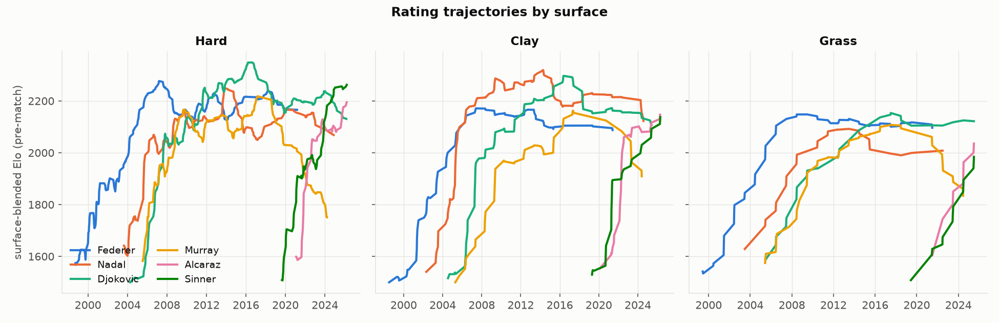

# Tennis Elo Simulator

[](https://github.com/lukahere007/tennis-elo-simulator/actions/workflows/ci.yml)

[](LICENSE)

**How predictable are professional tennis matches, and who is really most likely to win a Grand Slam?**

This project builds a surface-aware Elo rating system for ATP tennis (97,088 tour-level matches, January 1995 to April 2026). It is evaluated strictly walk-forward: the model is tuned on 2000–2014 and every later match is predicted using only earlier results. It then simulates every Grand Slam draw from 2015 to 2026 20,000 times, using only information available before the first ball.

## The answer

**About two-thirds of matches are predictable.** On 31,532 out-of-sample matches (2015 to April 2026), the player the model favoured won **65.6%** of the time. Grand Slam matches are easier to call (**73.0%**), because best-of-5 gives the stronger player more chances to come back.

| Model (tuned on 2000–2014, scored once on 2015–Apr 2026) | Log loss | Brier | Accuracy |
|---|---|---|---|
| **Surface-blend Elo + walk-forward recalibration** | **0.6123** | **0.2127** | 65.6% |
| Surface-blend Elo | 0.6156 | 0.2138 | 65.6% |
| Surface-blend Elo + margin of victory | 0.6158 | 0.2136 | 65.7% |
| Surface-blend Elo, no best-of-5 conversion | 0.6172 | 0.2143 | 65.6% |
| Logistic regression on log-rank difference | 0.6190 | 0.2157 | 64.9% |
| Elo tuned, overall rating only | 0.6196 | 0.2156 | 65.0% |
| Elo tuned, surface rating only | 0.6256 | 0.2180 | 64.6% |
| Elo with FiveThirtyEight's published parameters | 0.6261 | 0.2171 | 65.3% |
| "Higher-ranked player wins" (constant 66.1%) | 0.6485 | 0.2280 | 64.9% |

A coin flip scores 0.693 log loss. The ATP ranking already carries most of the signal. Careful rating work improves log loss by about 1% beyond a well-fitted ranking model (0.6123 vs 0.6190). Most of Elo's advantage comes from two things the 52-week ranking misses. It reacts faster, for example to a player returning from injury or a teenager on the rise. It also treats clay and grass as the different games they are.

**Who wins Slams?** Across 44 Grand Slams, from the 2015 Australian Open to the 2026 Australian Open (Wimbledon 2020 was cancelled):

- **The model's favourite won 19 of 44 (43%).** Summing the favourites' title probabilities gives an expected **18.0** wins, so the probabilities are about right. Even the strongest player in the draw is usually an underdog against the rest of the field.
- **The champion was in the model's top 3 in 40 of 44 Slams and in its top 8 in all 44.**
- **The title forecasts clearly beat a rank-only model.** Mean log loss of the champion's probability is **1.45** for Elo, **1.81** for the rank model and 4.85 if all 128 players are treated as equal. The multi-class Brier score is **0.679** vs **0.742** (uniform 0.992). Two examples where Elo saw what the ranking hid:
  - Federer at the 2017 Australian Open, returning from injury at No. 17: Elo gave him **11.7%**, the rank model **0.3%**.
  - Djokovic at Wimbledon 2018, at No. 21: Elo **25.7%**, the rank model **0.2%**.
  - The ranking won too. Wawrinka was No. 3 at the 2016 US Open; the rank model gave him 12.7%, Elo only 1.6%.
- **Next Slam after the data ends: Roland Garros 2026, on clay.**
  - Ratings are as of 22 April 2026. The field is the 128 highest-rated players active in the previous nine months, averaged over 1,000 random seeded draws.
  - Forecast: **Sinner 33%, Alcaraz 30%, Djokovic 15%, Zverev 6%, Fils 4%.**
  - The actual result is not in the dataset, so this forecast is untested here.









## What's creative here

**1. Two ratings per player, blended with a weight learned from data.** This is like a chess player who keeps a separate blitz rating. Each player has an overall Elo, updated after every match, and a hard, clay or grass Elo, updated only on that surface. The forecast mixes the two rating *differences*, `d = (1 − w)·ΔOverall + w·ΔSurface`, and the data set the weight to **w = 0.51**. Neither rating works as well alone (0.6196 overall-only, 0.6256 surface-only, 0.6156 blended). The surface rating is sharper but noisy because it sees fewer matches. The overall rating is stable, but it cannot see that Nadal on clay is a different player.

**2. A K-factor that cools down with experience.** The update step is `K = c / (n + o)^s` (FiveThirtyEight's form), where `n` is the number of matches the player had already played. Newcomers move fast and veterans settle. The parameters `c, o, s, w` are fitted jointly by Nelder–Mead to minimise log loss on 2000–2014 predictions only; 1995–1999 serves as burn-in. The fitted values are `c = 130, o = 10, s = 0.30`. Re-tuning alone takes log loss from 0.6261 to 0.6196 compared with the published defaults.

**3. Best-of-5 handled with probability theory instead of a fudge factor.**
- Elo's logistic curve is read as a best-of-3 win probability. For a best-of-5 match it is converted through the per-set probability `p`.
- Winning a best-of-3 match has probability `p²(3 − 2p)`. Winning a best-of-5 match has probability `p³(10 − 15p + 6p²)`, which is `p³[1 + 3(1−p) + 6(1−p)²]`, depending on how many sets are lost first.
- Both curves are strictly increasing, so one can be inverted and fed into the other. A 70% best-of-3 favourite has a per-set probability of 0.637 and becomes a **74.4%** best-of-5 favourite. Likewise 80% becomes 85.4% and 90% becomes 94.5%.
- The converted probability is also used as the expected score in the rating update. Otherwise a favourite who wins a five-setter would get credit for an outcome the longer format already made more likely.
- Out of sample, log loss improves from 0.6172 to 0.6156.

**4. Walk-forward recalibration.**
- The raw ratings are over-confident, as the blue line in the calibration plot shows, and more so since about 2018 as the field has evened out.
- The fix uses only past data. For each year, one multiplier on the rating difference is fitted to the previous three years' one-step-ahead forecasts and then applied to the new year. It falls from 0.94 in 2015 to 0.75 in 2026.
- Log loss drops to 0.6123, and the reliability curve lies on the diagonal.
- *Caveat:* the over-confidence was spotted on the test period. So the decision to add this step was informed by the test data, even though the step itself never sees a future result. The training period already showed a milder version of the problem (best hindsight multiplier 0.94).
- At the Slam-title level the step does not help. Without it, champion log loss is 1.38, Brier 0.676, and the favourite wins 20 of 44 against 20.6 expected. With it, log loss is 1.45. At Slams the top players really are as dominant as the raw ratings say.

**5. Draws rebuilt from results, then simulated.**
- The data has no draw sheets, but a knock-out bracket can be reconstructed from results alone. Each finalist came out of a semi-final, each semi-finalist out of a quarter-final, and so on down to the 64 first-round pairs.
- Each draw is played 20,000 times with ratings frozen the day before the event. Every match uses a surface-blended, best-of-5-converted probability. The bracket structure is kept, so a player whose quarter also holds Djokovic pays for it.
- As a check, the same title probabilities are computed **exactly** by dynamic programming over the bracket tree. P(i wins a sub-bracket) = P(i wins its half) × Σⱼ P(j wins the other half)·P(i beats j). The Monte Carlo and the exact values agree to within 0.75 percentage points for every player in every draw.

**Tried and dropped:** a margin-of-victory multiplier, which scales K by the winner's share of games. The fitted exponent is β = 1.56, but it makes no out-of-sample difference (0.6158 vs 0.6156), so it is reported but not used.

## How the evaluation stays honest

- **Forecasts are strictly one step ahead.** Each match is predicted from the ratings *before* its result is applied. Matches are ordered by date, then tournament, then round.
- **Tuning and testing are separate.** The Elo parameters (`c, o, s, w`, β) and both baselines are fitted on 2000–2014 only. The baselines are the "higher-ranked wins" rate and a log-rank logistic regression with a best-of-5 interaction. The test set (2015 to April 2026) is scored once.
- **Proper scoring rules.** Results are reported as log loss and Brier score, with a reliability diagram and two rank-based baselines. Walkovers and defaults are excluded from scoring and from rating updates but kept for draw reconstruction.
- **Slam forecasts use only pre-event information.** Ratings are snapshotted just before each event's first match. Player rankings come from the match table.

## Reproduce

```bash
git clone https://github.com/lukahere007/tennis-elo-simulator.git
cd tennis-elo-simulator
pip install -r requirements.txt

pytest -q                                  # 21 unit tests
python scripts/run_analysis.py             # full run: tuning + 20k sims per Slam (~7 min on a laptop CPU)
python scripts/run_analysis.py --fast      # reuse results/params.json, 2k sims (~15 s; what CI runs)

python scripts/fetch_data.py               # optional: re-download the raw match files
```

`data/atp_matches.parquet` (1.6 MB) is committed. It is produced by `scripts/fetch_data.py`, which the GitHub Actions workflow `.github/workflows/fetch-data.yml` runs before committing the result. Raw CSVs are cached in `data/raw/`, which git ignores.

## Repository layout

```
├── data/
│   ├── atp_matches.parquet       # ATP tour-level matches 1995 – Apr 2026 (derived, committed)
│   └── SOURCE.txt                # repository the raw files were fetched from
├── figures/                      # PNGs written by scripts/run_analysis.py
├── results/                      # params.json, match_metrics.csv, calibration.csv,
│                                 # slam_forecasts.csv, slam_player_probs.parquet,
│                                 # next_slam_forecast.csv, summary.json
├── scripts/
│   ├── fetch_data.py             # reproducible download
│   └── run_analysis.py           # tune -> walk-forward test -> Slam Monte Carlo -> figures
├── src/tennis_elo/
│   ├── data.py                   # loading, surface/round coding, walkover detection
│   ├── elo.py                    # surface-blend Elo, decaying K, Bo5-aware updates
│   ├── tennis_math.py            # best-of-3 <-> best-of-5 via per-set probability
│   ├── tuning.py                 # Nelder-Mead on training-period log loss
│   ├── evaluate.py               # scoring rules, calibration, baselines, recalibration
│   ├── simulate.py               # bracket reconstruction, Monte Carlo, exact DP
│   ├── slams.py                  # per-Slam forecasts, seeded random draws
│   └── plots.py
├── tests/                        # Elo symmetry/conservation, expected score, Bo3<->Bo5 values,
│                                 # 4-player bracket vs analytic answer, seeding, recalibration
└── .github/workflows/            # ci.yml (tests + fast analysis), fetch-data.yml
```

## Limitations

- **Tour-level matches only.** Challenger and qualifying matches are not used, so a young player's rating lags until he reaches the main tour. Davis Cup matches are included.
- **No injuries, fatigue or withdrawals.** Ratings do not decay during layoffs. The Roland Garros 2026 field is "the 128 best active players", not the real entry list, and seedings come from Elo rather than the ATP ranking.
- **Independent sets.** The best-of-5 conversion assumes every set is won with the same, independent probability. It ignores momentum and stamina over five sets.
- **44 Slams is a small sample.** "19 favourite wins against 18.0 expected" is consistent with good calibration, but it cannot rule out moderate miscalibration.
- **No betting-market baseline.** Closing odds are the hardest benchmark and would probably beat every model here. They are not in this dataset.
- **Data provenance.** The original `JeffSackmann/tennis_atp` repository was not publicly reachable when the data were fetched (November 2026). `fetch_data.py` tries the original first and then falls back to public mirrors of the same files. The mirror actually used, `zvonimir-rezo/tennis_atp`, is recorded in `data/SOURCE.txt`. Yearly match counts look like the original series (about 2,700–3,800 per year, with a 2020 COVID dip), but the files have not been checked one by one against Sackmann's originals. The 2026 data end on 22 April.

## Data source and licence

Match data: **Jeff Sackmann / Tennis Abstract**, [`tennis_atp`](https://github.com/JeffSackmann/tennis_atp), licensed under [Creative Commons Attribution-NonCommercial-ShareAlike 4.0 International](https://creativecommons.org/licenses/by-nc-sa/4.0/). The derived data in `data/` and `results/` are under the same terms: **non-commercial use only**, with attribution, and any adaptation must be shared alike. The code is MIT-licensed (see [LICENSE](LICENSE)); that licence covers only the code, not the data.

Author: Luke Wamalwa
